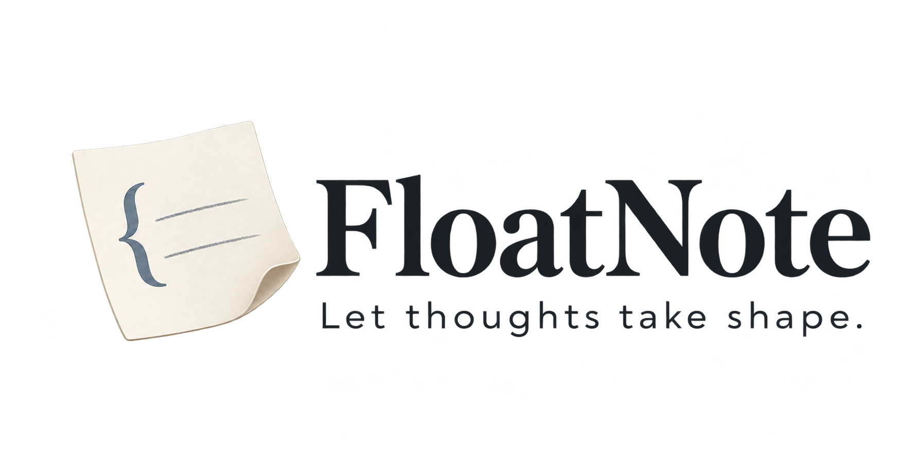

  <a href="README.md">简体中文</a> | <strong>English</strong>

  

  

  
A local note-taking app that floats on your desktop, helping you turn reading into writing.

  

    <a href="https://github.com/nanshine/FloatNote/releases/latest/download/FloatNote_aarch64.dmg"><strong>Download for macOS · Apple Silicon</strong></a>
    &nbsp;·&nbsp;
    <a href="https://github.com/nanshine/FloatNote/releases/latest/download/FloatNote_x86_64.dmg"><strong>Download for macOS · Intel</strong></a>
    &nbsp;·&nbsp;
    <a href="https://github.com/nanshine/FloatNote/releases/latest/download/FloatNote_x86_64-setup.exe"><strong>Download for Windows · x86_64</strong></a>
  

  
<a href="https://github.com/nanshine/FloatNote/releases/latest">View the latest stable release and release notes</a>

## Why FloatNote?

1. Keep your notes always on top and capture ideas without interrupting your work.
2. Work on one project at a time and stay focused on what is in front of you.
3. Keep captured material beside your writing, so you can read and develop your ideas together.
4. Store notes locally as Markdown files that you can view, back up, and move at any time.
5. Think things through with AI that asks follow-up questions and helps organize your thoughts.

## From reading to your own perspective

<table>
<tr>
<td width="42%" valign="middle">
<h3>Capture without breaking your flow</h3>

Your always-on-top note window stays within reach while you work in other apps. Select text to quickly capture it, translate it, or ask AI a question with the original passage as context.

</td>
<td width="58%" align="center" valign="middle">
<video src="https://github.com/user-attachments/assets/285785c3-c792-4485-b122-fd0899244412" controls muted playsinline preload="metadata" poster="assets/posters/02-capture.jpg" width="100%" aria-label="FloatNote floating capture, translation, and AI questions demo"></video>
</td>
</tr>
</table>

<table>
<tr>
<td width="58%" align="center" valign="middle">
<video src="https://github.com/user-attachments/assets/d316515a-72b4-48e7-87dd-8f72f870322c" controls muted playsinline preload="metadata" poster="assets/posters/03-dual-panel.jpg" width="100%" aria-label="FloatNote side-by-side capture and writing workspace demo"></video>
</td>
<td width="42%" valign="middle">
<h3>Read your sources while developing your ideas</h3>

Keep what you collect while reading in the capture panel, and use the writing panel to organize and develop your own ideas. With your sources and draft side by side, there is no need to switch back and forth between pages.

</td>
</tr>
</table>

<table>
<tr>
<td width="42%" valign="middle">
<h3>Think more clearly through follow-up questions</h3>

FloatNote’s AI helps you form your own judgment through follow-up questions, organizing material, planning, and collaborative writing, as well as answering your questions.

</td>
<td width="58%" align="center" valign="middle">
<video src="https://github.com/user-attachments/assets/a6f85cf4-7eec-4f66-ac57-c31e33ce541b" controls muted playsinline preload="metadata" poster="assets/posters/04-socratic-ai.jpg" width="100%" aria-label="FloatNote AI follow-up questions and change confirmation demo"></video>
</td>
</tr>
</table>

| AI capabilities | What is supported |
| --- | --- |
| Core capabilities | Read and search project content, create and edit drafts, update action lists, add and manage tags, and search and read web pages |
| Built-in Skills | Ask until you understand, organize material, plan your next step, and put your thoughts into words |
| AI providers | OpenAI (including custom compatible endpoints), Anthropic, DeepSeek, Kimi, and Zhipu |

## Your notes live in local files

<table>
<tr>
<td width="58%" align="center" valign="middle">
<video src="https://github.com/user-attachments/assets/9297a1c1-1687-4aad-a3d8-3af3050aeff9" controls muted playsinline preload="metadata" poster="assets/posters/05-local-files.jpg" width="100%" aria-label="FloatNote local Markdown files and project spaces demo"></video>
</td>
<td width="42%" valign="middle">

Notes, action lists, and drafts are saved as Markdown files directly in a local folder you choose. Use your familiar file tools to view, back up, and move them; your content remains accessible independently of FloatNote.

</td>
</tr>
</table>

## Organize, take action, and revisit earlier versions

<table>
<tr>
<td width="33%" align="center" valign="top">
<video src="https://github.com/user-attachments/assets/a2823cd5-0fbf-4358-9153-1ceee3ee8387" controls muted playsinline preload="metadata" poster="assets/posters/06-tags.jpg" width="100%" aria-label="FloatNote tags demo"></video>
<h3>Tags</h3>

Tag important passages to organize and find scattered pieces of information.

</td>
<td width="33%" align="center" valign="top">
<video src="https://github.com/user-attachments/assets/a1aea003-0afa-4770-909c-dad44068dc85" controls muted playsinline preload="metadata" poster="assets/posters/07-action-menu.jpg" width="100%" aria-label="FloatNote action menu and next steps demo"></video>
<h3>Next steps</h3>

Use the action menu to identify what you can do next.

</td>
<td width="33%" align="center" valign="top">
<video src="https://github.com/user-attachments/assets/b6ff4ac7-7e67-4a18-8c58-db65b2c8e00b" controls muted playsinline preload="metadata" poster="assets/posters/08-versions.jpg" width="100%" aria-label="FloatNote draft version history demo"></video>
<h3>Version history</h3>

Save and revisit different versions of your drafts to see how your writing evolves.

</td>
</tr>
</table>

## Download and get started

The links below download the installer for your platform from the latest stable GitHub release.

- **Apple Silicon Mac** (M1/M2/M3/M4 and later): [Download the latest `.dmg`](https://github.com/nanshine/FloatNote/releases/latest/download/FloatNote_aarch64.dmg)
- **Intel Mac**: [Download the latest `.dmg`](https://github.com/nanshine/FloatNote/releases/latest/download/FloatNote_x86_64.dmg)
- **Windows x86_64**: [Download the latest installer](https://github.com/nanshine/FloatNote/releases/latest/download/FloatNote_x86_64-setup.exe)
- **All versions and release notes**: [View GitHub Releases](https://github.com/nanshine/FloatNote/releases)

The macOS installers are signed with Developer ID and notarized by Apple. Windows installers support signature verification for in-app updates, but do not yet use Authenticode signing, so Windows may show an unknown publisher or SmartScreen prompt during the first installation.

After installing, open FloatNote and follow the onboarding guide to create your first project. Try capturing a passage, then write down your own thoughts. You can dismiss the guide at any time and restart it later from Settings → General → Onboarding.

To capture selected text on a Mac, enable Accessibility permissions when prompted. When you are ready to use the AI assistant, configure a provider in Settings → AI.

## Contributing

Bug reports, feature suggestions, and contributions are welcome. Read the [contribution guide](CONTRIBUTING.md) for development setup, submission conventions, and validation requirements. To run from source, see the [development setup guide](docs/development/setup.md).

## License

This project is open source under the [MIT License](LICENSE). Copyright belongs to the FloatNote contributors.
